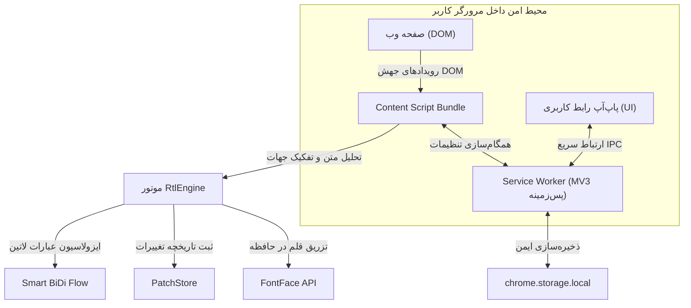

<div dir="rtl" align="right">

# 🎨 RTL Atelier | دستیار هوشمند تایپوگرافی و راست‌چین‌سازی وب

<p align="center">
  
</p>

<p align="center">
  <strong>موتور هوشمند، محلی و فوق‌سریع اصلاح متون دوزبانه (فارسی و انگلیسی) در وب مدرن و چت‌بات‌های هوش مصنوعی</strong>
</p>

<p align="center">
  <a href="LICENSE"></a>
  <a href="manifest.json"></a>
  <a href="package.json"></a>
  <a href="tests/"></a>
  <a href="README_EN.md"></a>
</p>

<p align="center">
  <a href="README_EN.md"><b>[ English Documentation | مستندات انگلیسی ]</b></a>
</p>

---

## 📖 فهرست مطالب

1. [چرا RTL Atelier؟ (بیان مسئله و تمایز کلیدی)](#-چرا-rtl-atelier-بیان-مسئله-و-تمایز-کلیدی)
2. [حالت‌های سه‌گانه چیدمان و جهت متن](#-حالت‌های-سه‌گانه-چیدمان-و-جهت-متن)
3. [قابلیت‌های شاخص و نوآوری‌های نسخه جدید](#-قابلیت‌های-شاخص-و-نوآوری‌های-نسخه-جدید)
   - [مرکز پیشرفته عیب‌یابی و پایش زنده صفحه](#۱-مرکز-پیشرفته-عیب‌یابی-و-پایش-زنده-صفحه-diagnostics--troubleshooting-center)
   - [بارگذاری فونت ۱۰۰٪ مصون از محدودیت‌های امنیتی](#۲-بارگذاری-فونت-۱۰۰-مصون-از-محدودیت‌های-امنیتی-csp-immune-font-loader)
   - [زمان‌بند ۶۰ فریم بر ثانیه و هماهنگ با ری‌اکت](#۳-زمان‌بند-۶۰-فریم-بر-ثانیه-و-هماهنگ-با-ری‌اکت-scheduler)
   - [ناوبری بی‌نقص در چت‌های قبلی و پلتفرم‌های تک‌صفحه‌ای](#۴-ناوبری-بی‌نقص-در-چت‌های-قبلی-و-پلتفرم‌های-تک‌صفحه‌ای-spa-navigation)
4. [قلم‌های توکار و پشتیبانی از قلم دلخواه](#-قلم‌های-توکار-و-پشتیبانی-از-قلم-دلخواه)
5. [اصلاح هوشمند خط، نیم‌فاصله و نشانه‌گذاری](#-اصلاح-هوشمند-خط-نیم‌فاصله-و-نشانه‌گذاری)
6. [راهنمای گام‌به‌گام نصب و راه‌اندازی](#-راهنمای-گام‌به‌گام-نصب-و-راه‌اندازی)
7. [کلیدهای میانبر](#-کلیدهای-میانبر)
8. [معماری فنی و امنیت ۱۰۰٪ محلی](#-معماری-فنی-و-امنیت-۱۰۰-محلی)
9. [راهنمای توسعه‌دهندگان و آزمون‌ها](#-راهنمای-توسعه‌دهندگان-و-آزمون‌ها)
10. [مجوز و مشارکت](#-مجوز-و-مشارکت)

---

## 🔍 چرا RTL Atelier؟ (بیان مسئله و تمایز کلیدی)

در وب امروز، به‌ویژه هنگام تعامل با پلتفرم‌های مدرن هوش مصنوعی نظیر <bdi dir="ltr">ChatGPT</bdi>، <bdi dir="ltr">Claude</bdi>، <bdi dir="ltr">DeepSeek</bdi>، <bdi dir="ltr">Gemini</bdi>، <bdi dir="ltr">Qwen</bdi>، <bdi dir="ltr">Grok</bdi> و <bdi dir="ltr">Perplexity</bdi>، ترکیب زبان‌های راست‌به‌چپ (فارسی و عربی) با زبان‌های چپ‌به‌راست (انگلیسی، کدها و شناسه‌ها) با مشکلات جدی مواجه است:

* 💥 **جابجایی کلمات و نسخه‌ها:** ترکیب کلمات انگلیسی و اعداد (مانند <bdi dir="ltr">`GPT-4`</bdi> یا <bdi dir="ltr">`Python 3.12`</bdi>) در متن فارسی معکوس شده و به صورت <bdi dir="ltr">`4-GPT`</bdi> نمایش می‌یابد.
* 🌀 **تخریب چیدمان سایت‌ها (<bdi dir="ltr">Layout Breakdown</bdi>):** افزونه‌های ساده با اعمال مستقیم و سراسری جهت راست‌به‌چپ، ساختار فلکس‌باکس و گرید صفحات را جابجا می‌کنند و منوها و داشبوردها به هم می‌ریزند.
* 🔒 **مسدودسازی قلم توسط سیاست‌های امنیتی (<bdi dir="ltr">CSP Block</bdi>):** سرویس‌های حساسی مانند کلاد به دلیل قوانین امنیتی سخت‌گیرانه، اجازهٔ بارگذاری فایل‌های فونت را از طریق لینک‌های وب یا استایل‌شیت‌های معمولی نمی‌دهند.
* 🕳️ **پدیدار نشدن تغییرات در چت‌های قدیمی و اسکرول مجازی:** هنگام تعویض گفتگوها در برنامه‌های تک‌صفحه‌ای یا اسکرول کردن پیام‌های گذشته، تغییرات متن اعمال نمی‌شوند و نیاز به رفرش مداوم ایجاد می‌شود.

<bdi dir="ltr">**RTL Atelier**</bdi> پاسخی مهندسی‌شده و قطعی به تمام این چالش‌هاست: یک موتور دوجهتهٔ مستقل و بلادرنگ در مرورگر که هر پاراگراف را به صورت مجزا تحلیل نموده، اصطلاحات فنی را ایزوله می‌کند، قلم‌های زیبای فارسی را بدون تداخل اعمال می‌نماید و در عین حال ساختار لایوت سایت و بلوک‌های کد را کاملاً حفظ می‌کند.

```text
[نمایش پیش‌فرض و به‌هم‌ریخته مرورگرها]
نادرست:  است . GPT-4 مدل جدیدترین این (نرم افزار)
نادرست:  مي روم و مي گويم .

[نمایش استاندارد با RTL Atelier]
درست:   این جدیدترین مدل GPT-4 است. (نرم‌افزار)
درست:   می‌روم و می‌گویم.
```

---

## 🧭 حالت‌های سه‌گانه چیدمان و جهت متن

<bdi dir="ltr">RTL Atelier</bdi> دارای سه حالت جهت‌دهی دقیق برای سناریوهای مختلف مطالعه و وب‌گردی است:

| حالت چیدمان | عملکرد دقیق و رفتار مهندسی‌شده | سناریوی کاربردی |
| :--- | :--- | :--- |
| **<bdi dir="ltr">`Auto`</bdi> (هوشمند)** | **سازماندهی هوشمند متن بدون دستکاری لایوت:** تنها پاراگراف‌ها، لیست‌ها و متون فارسی راست‌چین می‌شوند. ساختار کلی صفحه، ستون‌های وب‌سایت، المان‌های فلکس و گرید کاملاً دست‌نخورده باقی می‌مانند. | وب‌گردی روزمره، مطالعه مقالات، کار با فرم‌ها و داشبوردهای اداری |
| **<bdi dir="ltr">`RTL`</bdi> (راست‌چین سراسری)** | **بهینه‌سازی کامل ساختار برای زبان فارسی:** کل بدنه، جداول، سایدبارها و منوها راست‌چین می‌شوند، دقیقاً مثل اینکه سایت از ابتدا برای زبان فارسی طراحی شده باشد. بلوک‌های کد و فرمول‌های ریاضی محافظت می‌شوند. | چت‌بات‌های خارجی و سایت‌های مطالعهٔ متنی که نیاز به چیدمان بومی دارند |
| **<bdi dir="ltr">`LTR`</bdi> (چپ‌چین سراسری)** | **چیدمان استاندارد انگلیسی به همراه قلم دلخواه:** جهت صفحه کاملاً چپ‌به‌راست تنظیم شده و فونت انتخابی کاربر روی متون اعمال می‌شود؛ بدون تغییر در ارقام و ساختار لاتین. | مطالعه مستندات فنی و مقالات انگلیسی با فونت سفارشی |

> [!TIP]
> **بازگشت‌پذیری ۱۰۰٪:** با بازگشت از حالت‌های <bdi dir="ltr">`RTL`</bdi> یا <bdi dir="ltr">`LTR`</bdi> به حالت <bdi dir="ltr">`Auto`</bdi>، کلیهٔ صفات و استایل‌های تغییر یافته دقیقاً به وضعیت اولیه سایت بازمی‌گردند.

---

## ⚡ قابلیت‌های شاخص و نوآوری‌های نسخه جدید

### ۱. مرکز پیشرفته عیب‌یابی و پایش زنده صفحه (<bdi dir="ltr">Diagnostics & Troubleshooting Center</bdi>)

یک محیط مانیتورینگ بلادرنگ درون پاپ‌آپ افزونه که اطلاعات کاملی از وضعیت صفحه در اختیارتان می‌گذارد:
* **نشانگر زنده سلامت (<bdi dir="ltr">Health Indicator</bdi>):** پایش وضعیت موتور در نوار عنوان پاپ‌آپ با رنگ‌های سبز، زرد و قرمز.
* **شبکه تله‌متری ۲×۲ (<bdi dir="ltr">Live Telemetry Grid</bdi>):**
  - **پاراگراف‌های شناسایی‌شده:** تعداد دقیق بلوک‌های متنی صفحه و درصد پوشش متن فارسی.
  - **حالت جهت متن:** نمایش وضعیت فعال (<bdi dir="ltr">`Auto`</bdi> ،<bdi dir="ltr">`RTL`</bdi> یا <bdi dir="ltr">`LTR`</bdi>).
  - **محیط‌های چت شناسایی‌شده:** تشخیص هوشمند کانتینرهای پیام در پلتفرم‌های هوش مصنوعی.
  - **صف پردازش زمان‌بند:** بررسی لحظه‌ای عمق صف و اطمینان از عملکرد بدون وقفه.
* **بررسی وضعیت قلم و امنیت (<bdi dir="ltr">Font & CSP Security Verification</bdi>):** اعتبارسنجی زندهٔ بارگذاری قلم در حافظه از طریق <bdi dir="ltr">`document.fonts.check()`</bdi>.
* **توصیه‌های هوشمند رفع اختلال:** ارائهٔ راهکارهای پویا در صورت تأخیر در رندرینگ سایت‌ها.
* **دکمه «اسکن عمیق و رفع فوری مشکل» (<bdi dir="ltr">Run Deep Scan & Quick Fix</bdi>):** بازنشانی سریع و اسکن لحظه‌ای المان‌های صفحه بدون نیاز به بارگذاری مجدد (<bdi dir="ltr">Reload</bdi>).
* **دکمه «کپی گزارش کامل» (<bdi dir="ltr">Copy Full Technical Report</bdi>):** تهیه گزارش ساختاریافته در قالب مارک‌داون برای ارسال یا بررسی فنی.

---

### ۲. بارگذاری فونت ۱۰۰٪ مصون از محدودیت‌های امنیتی (<bdi dir="ltr">CSP-Immune Font Loader</bdi>)

پلتفرم‌هایی نظیر <bdi dir="ltr">Claude.ai</bdi> دارای هدرهای امنیتی سخت‌گیرانه‌ای هستند که فونت‌های تزریق‌شده از طریق فایل‌های وب را مسدود می‌کنند:
* در <bdi dir="ltr">RTL Atelier</bdi>، بایت‌های باینری قلم از طریق پردازش پس‌زمینه با دسترسی ممتاز خوانده شده و مستقیماً به حافظه اسکریپت صفحه منتقل می‌شوند.
* فونت با استفاده از <bdi dir="ltr">`new FontFace(family, arrayBuffer)`</bdi> و متد <bdi dir="ltr">`document.fonts.add()`</bdi> در لحظه فعال می‌شود. این روش هیچ درخواست شبکه‌ای ارسال نکرده و به طور ۱۰۰٪ از قوانین <bdi dir="ltr">CSP</bdi> عبور می‌کند.

---

### ۳. زمان‌بند ۶۰ فریم بر ثانیه و هماهنگ با ری‌اکت (<bdi dir="ltr">60fps Frame-Budget Scheduler</bdi>)

* بهینه‌سازی زمان‌بندی پردازش متن با بودجهٔ ۱۶ میلی‌ثانیه‌ای در هر فریم نمایش.
* استفاده از <bdi dir="ltr">`requestAnimationFrame`</bdi> همراه با ترن‌های سریع <bdi dir="ltr">`setTimeout(0)`</bdi> مانع از گرسنگی حلقه رندر ری‌اکت ۱۸ (<bdi dir="ltr">React 18 Concurrent Starvation</bdi>) در چت‌های سنگین می‌شود.

---

### ۴. ناوبری بی‌نقص در چت‌های قبلی و پلتفرم‌های تک‌صفحه‌ای (<bdi dir="ltr">SPA Navigation & Hydration Sweeps</bdi>)

* پاکسازی خودکار کش گره‌ها هنگام جابجایی بین گفتگوهای گذشته.
* اجرای امواج چندمرحله‌ای جاروب هیدراسیون در زمان‌های ۸۰، ۲۰۰، ۵۰۰، ۱۲۰۰ و ۲۵۰۰ میلی‌ثانیه برای اعمال فونت و راست‌چین‌سازی بدون وقفه.

---

## 🔤 قلم‌های توکار و پشتیبانی از قلم دلخواه

<bdi dir="ltr">RTL Atelier</bdi> با ۷ خانواده قلم فارسی با وزن‌های گوناگون عرضه می‌شود:

* 💎 **وزیر (<bdi dir="ltr">Vazir</bdi>):** قلم پیش‌فرض مدرن و فوق‌العاده خوانا در ۵ وزن (<bdi dir="ltr">Thin, Light, Regular, Medium, Bold</bdi>)
* 🍃 **شبنم (<bdi dir="ltr">Shabnam</bdi>):** قلم چشم‌نواز و نرم در ۵ وزن
* 🌊 **ساحل (<bdi dir="ltr">Sahel</bdi>):** قلم شیک با خوانایی عالی در ۳ وزن (<bdi dir="ltr">Regular, Bold, Black</bdi>)
* ☀️ **صمیم (<bdi dir="ltr">Samim</bdi>):** قلم مینیمال و تمیز در ۲ وزن
* 🕊️ **پرستو (<bdi dir="ltr">Parastoo</bdi>):** قلم رسمی و متوازن در ۲ وزن
* 🌾 **گندم (<bdi dir="ltr">Gandom</bdi>):** قلم سنتی با هندسهٔ دقیق
* 🌸 **تنها (<bdi dir="ltr">Tanha</bdi>):** قلم مناسب تیترها و عناوین

### قابلیت بارگذاری قلم دلخواه با کشیدن و رها کردن (<bdi dir="ltr">Drag & Drop</bdi>):
کافیست فایل فونت دلخواه خود را با پسوندهای <bdi dir="ltr">`.woff2`</bdi>، <bdi dir="ltr">`.woff`</bdi>، <bdi dir="ltr">`.ttf`</bdi> یا <bdi dir="ltr">`.otf`</bdi> داخل پنجره پاپ‌آپ رها کنید تا درجا به فهرست قلم‌ها اضافه شده و روی صفحات وب اعمال گردد.

---

## ✍️ اصلاح هوشمند خط، نیم‌فاصله و نشانه‌گذاری

* 🔄 **یکسان‌سازی حروف:** تبدیل خودکار «<bdi dir="ltr">ي</bdi>» و «<bdi dir="ltr">ك</bdi>» عربی به «<bdi dir="ltr">ی</bdi>» و «<bdi dir="ltr">ک</bdi>» فارسی و حذف کشیدگی‌های غیرضروری (<bdi dir="ltr">تطویل</bdi>).
* ✂️ **تنظیم هوشمند نیم‌فاصله (<bdi dir="ltr">ZWNJ</bdi>):** درج نیم‌فاصله استاندارد در پیشوندهای «<bdi dir="ltr">می‌/نمی‌</bdi>» و پسوندهای جمع و تفضیلی («<bdi dir="ltr">‌ها/‌های/ترین</bdi>»).
* 📐 **تنظیم فواصل علائم نگارشی:** اصلاح چسبیدگی و فاصلهٔ استاندارد در ویرگول، نقطه، دونقطه، پرانتزها و علامت سؤال.
* 🔢 **تبدیل هوشمند ارقام:** امکان تبدیل ارقام به فارسی با حفظ هوشمندانهٔ عبارات فنی، کدها، کلاس‌های <bdi dir="ltr">CSS</bdi> و آدرس‌های <bdi dir="ltr">IP</bdi>.

---

## 🚀 راهنمای گام‌به‌گام نصب و راه‌اندازی

### نصب آسان در مرورگرهای مبتنی بر کروم (<bdi dir="ltr">Chrome, Edge, Brave, Opera</bdi>):

برای اجرای نسخهٔ توسعه، ابتدا build را بسازید؛ چون پوشهٔ `dist/` فایل تولیدی است و عمداً در Git ذخیره نمی‌شود.

۱. مخزن را کلون کنید و build تولیدی را بسازید:
```bash
git clone https://github.com/<YOUR_USERNAME>/rtl-atelier.git
cd rtl-atelier
npm run build
```

۲. مرورگر خود را باز کرده و به بخش مدیریت افزونه‌ها بروید:
```text
chrome://extensions
```

۳. گزینهٔ **<bdi dir="ltr">Developer mode</bdi>** را روشن کنید.

۴. روی **<bdi dir="ltr">Load unpacked</bdi>** کلیک کرده و پوشهٔ ریشهٔ پروژهٔ `Smart-RTL` را انتخاب کنید.

۵. پس از هر تغییر در کد، برای بازسازی فایل‌های تولیدی دوباره `npm run build` را اجرا کنید و افزونه را در صفحهٔ Extensions با **Reload** بازخوانی کنید.

---

## ⌨️ کلیدهای میانبر

| کلید میانبر | عملکرد |
| :--- | :--- |
| <kbd>Alt</kbd> + <kbd>Shift</kbd> + <kbd>R</kbd> | فعال یا غیرفعال کردن افزونه روی وب‌سایت جاری |
| <kbd>Alt</kbd> + <kbd>Shift</kbd> + <kbd>T</kbd> | روشن یا خاموش کردن کلید اصلی افزونه در سراسر مرورگر |

*(امکان سفارشی‌سازی کلیدها در آدرس <bdi dir="ltr">`chrome://extensions/shortcuts`</bdi> فراهم است)*

---

## 🏗️ معماری فنی و امنیت ۱۰۰٪ محلی



* 🛡️ **حفظ کامل حریم خصوصی (<bdi dir="ltr">Zero Telemetry</bdi>):** هیچ داده‌ای از متون یا تاریخچهٔ مرور شما به هیچ سروری ارسال نمی‌شود؛ تمام پردازش‌ها ۱۰۰٪ داخل حافظه مرورگر شما انجام می‌پذیرد.
* ⚡ **بدون هیچ‌گونه وابستگی خارجی (<bdi dir="ltr">Zero Dependencies</bdi>):** تمام هسته پروژه بدون استفاده از فریم‌ورک‌های سنگین و تنها با استانداردهای بومی وب توسعه داده شده است.
* 🧩 **سازگاری کامل با <bdi dir="ltr">Manifest V3</bdi>:** بر اساس جدیدترین رهنمودهای امنیتی وب و پلتفرم افزونه‌های گوگل.

---

## 🧪 راهنمای توسعه‌دهندگان و آزمون‌ها

پروژه دارای **۲۱۷ آزمون خودکار** برای تضمین پایداری در انواع سناریوها، آزمون‌های مرزی و پلتفرم‌های چت است:

```bash
# اجرای مجموعه کامل آزمون‌ها
npm test

# بازتولید فایل‌های قلم و مانیفست‌ها
npm run fonts

# بیلد و باندل کدهای اسکریپت
npm run bundle

# ساخت بسته انتشار zip افزونه
npm run package

# اعتبارسنجی کامل چرخه انتشار (Tests + Icons + Fonts + Bundles + Package + Smoke)
npm run verify
```

---

## 📄 مجوز و مشارکت

این پروژه به عنوان یک نرم‌افزار آزاد تحت مجوز معتبر [MIT License](LICENSE) منتشر شده است. از نظرات، گزارش مشکلات و مشارکت‌های سازندهٔ شما به گرمی استقبال می‌کنیم.

</div>
