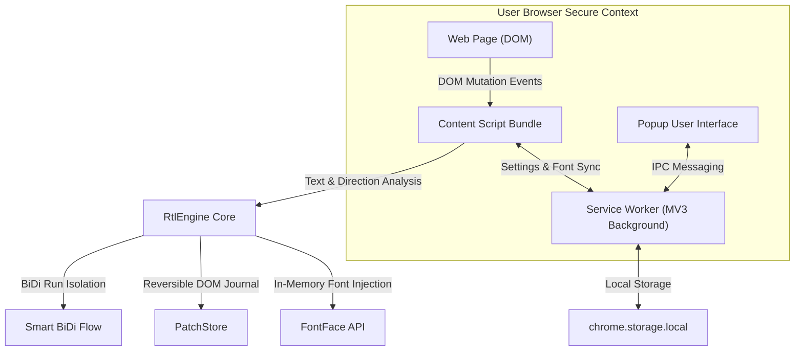

# 🎨 RTL Atelier | Intelligent Bilingual Web Typography Assistant

<p align="center">
  
</p>

<p align="center">
  <strong>An adaptive, local-first, zero-dependency bilingual typography and bidirectional text engine for Persian/Arabic + English across the modern web and AI chat platforms.</strong>
</p>

<p align="center">
  <a href="LICENSE"></a>
  <a href="manifest.json"></a>
  <a href="package.json"></a>
  <a href="tests/"></a>
  <a href="README.md"></a>
</p>

<p align="center">
  <a href="README.md"><b>[ مستندات فارسی | Persian Documentation ]</b></a>
</p>

---

## 📖 Table of Contents

1. [Why RTL Atelier? (The Problem & Breakthrough Solution)](#-why-rtl-atelier-the-problem--breakthrough-solution)
2. [Tri-State Orientation Architecture](#-tri-state-orientation-architecture)
3. [Key Innovations & Architecture Highlights](#-key-innovations--architecture-highlights)
   - [Diagnostics & Troubleshooting Center](#1-diagnostics--troubleshooting-center)
   - [100% CSP-Immune In-Memory FontFace Engine](#2-100-csp-immune-in-memory-fontface-engine)
   - [60fps Frame-Budget Scheduler](#3-60fps-frame-budget-scheduler)
   - [SPA Navigation & Proactive Hydration Sweeps](#4-spa-navigation--proactive-hydration-sweeps)
4. [Bundled Typefaces & Drag-and-Drop Custom Fonts](#-bundled-typefaces--drag-and-drop-custom-fonts)
5. [Smart Orthography, Half-Spacing & Punctuation](#-smart-orthography-half-spacing--punctuation)
6. [Step-by-Step Installation Guide](#-step-by-step-installation-guide)
7. [Keyboard Shortcuts](#-keyboard-shortcuts)
8. [Technical Architecture & Local Privacy](#-technical-architecture--local-privacy)
9. [Developer Guide & Verification Pipeline](#-developer-guide--verification-pipeline)
10. [License & Contributing](#-license--contributing)

---

## 🔍 Why RTL Atelier? (The Problem & Breakthrough Solution)

When right-to-left languages (Persian and Arabic) meet left-to-right scripts (English, code snippets, numbers, technical terms) on modern web applications—especially generative AI chats such as **ChatGPT**, **Claude**, **DeepSeek**, **Gemini**, **Qwen**, **Grok**, and **Perplexity**—standard browser rendering engines routinely break down:

* 💥 **Scrambled technical terms & versions:** Mixing Latin keywords and numbers (such as `GPT-4` or `Python 3.12`) within Persian text reverses tokens into unreadable artifacts like `4-GPT`.
* 🌀 **Destructive layout breakage:** Naive browser extensions flip entire page flex/grid containers, breaking web app layouts, destroying navigation bars, and distorting dashboard sidebars.
* 🔒 **Silent CSP font blocks:** Modern high-security platforms (like Claude.ai) enforce strict Content Security Policies (`font-src 'self' data: https:`) that reject external font files or blob injections.
* 🕳️ **Missed virtual scroll & previous chat views:** In single-page applications, previous conversation threads or lazy-loaded messages mount dynamically without triggering legacy direction scripts, requiring frustrating manual refreshes.

**RTL Atelier is an engineered, browser-native bidirectional typography assistant.** It inspects text paragraph by paragraph, isolates bidirectional boundaries, applies standard Persian typography rules, loads custom typefaces in memory, and guarantees 100% reversible DOM modifications without disrupting host layouts.

```text
[Standard Browser Rendering]
Broken:  است . GPT-4 مدل جدیدترین این (نرم افزار)
Broken:  مي روم و مي گويم .

[With RTL Atelier Activated]
Clean:   این جدیدترین مدل GPT-4 است. (نرم‌افزار)
Clean:   می‌روم و می‌گویم.
```

---

## 🧭 Tri-State Orientation Architecture

RTL Atelier introduces three distinct text orientation modes tailored for different reading and editing workflows:

| Mode | Precise Engineering Behavior | Best For |
| :--- | :--- | :--- |
| **`Auto`** | **Intelligent text-only organization:** Only paragraphs, lists, and input fields containing Persian/Arabic text receive bidirectional alignment and typography repair. Structural containers (flexbox, grid, tables) and English text remain completely untouched. | Daily web browsing, reading articles, dashboard interfaces, and mixed-language tools |
| **`RTL`** | **Native Persian page-level restructuring:** Optimizes the entire web page structure as if natively designed for Persian. Root document, body, forms, tables, and lists flow right-to-left with Persian line-height (`1.68`), while code blocks and math formulas stay strictly protected in LTR. | Foreign AI chat platforms, documentation, and pages requiring comprehensive RTL mirroring |
| **`LTR`** | **Native English page-level layout + Custom Font:** Optimizes layout for English left-to-right reading, disables Persian text transformations, and applies the user's selected typeface cleanly across the page. | Reading English technical docs and code with chosen custom fonts |

> [!TIP]
> **100% Reversibility:** Switching from `RTL` or `LTR` back to `Auto` cleanly restores the original web page attributes and UI structure without residual styling or layout shifts.

---

## ⚡ Key Innovations & Architecture Highlights

### 1. Diagnostics & Troubleshooting Center

A dedicated real-time inspection modal right inside the extension popup:
* **Live System Health Indicator:** Visual state badge (Green/Amber/Red) displaying operational status at a glance.
* **2×2 Live Telemetry Grid:**
  - **Detected Paragraphs:** Total block count and real-time RTL coverage percentage.
  - **Text Orientation Mode:** Shows active orientation mode (`Auto`, `RTL`, or `LTR`).
  - **Chat Message Containers:** Displays detected AI conversation containers.
  - **Scheduler Queue:** Live queue depth verifying smooth, unblocked processing.
* **Font & CSP Security Verification:** Verifies in-memory `FontFace` activation via `document.fonts.check()`.
* **Dynamic Actionable Recommendations:** Surfaces tailored advice if a page's elements mount with delay.
* **"Run Deep Scan & Quick Fix" Button:** Instantly performs a full DOM hydration sweep and refreshes telemetry in real time without page reload.
* **"Copy Full Technical Report" Button:** Generates a structured Markdown diagnostic report ready for debugging or issue reports.

---

### 2. 100% CSP-Immune In-Memory FontFace Engine

High-security web platforms (including Claude.ai) strictly block extension stylesheets and web fonts via `font-src` headers:
* In RTL Atelier, font binaries are fetched by the background service worker in its privileged context and transferred directly as ArrayBuffers to the content script.
* Fonts are loaded into memory via `new FontFace(family, arrayBuffer)` and `document.fonts.add(face)`.
* Zero external network requests are made, completely bypassing CSP restrictions and delivering immediate typeface rendering.

---

### 3. 60fps Frame-Budget Scheduler

* Replaced `requestIdleCallback` with a high-performance 16ms `requestAnimationFrame` and `setTimeout(0)` scheduling loop.
* Eliminates React 18 concurrent loop starvation during intensive chat mounting and streaming on platforms like Claude and DeepSeek.

---

### 4. SPA Navigation & Proactive Hydration Sweeps

* On single-page application route transitions (switching between chat threads), stale processed node maps are flushed automatically.
* Proactive hydration sweeps fire at `[80ms, 200ms, 500ms, 1200ms, 2500ms]` intervals, ensuring lazy-rendered messages and virtualized chat history format immediately.

---

## 🔤 Bundled Typefaces & Drag-and-Drop Custom Fonts

RTL Atelier ships with 7 open-source Persian typeface families across 19 bundled font faces:

* 💎 **Vazir:** Modern, highly legible default typeface in 5 weights (*Thin, Light, Regular, Medium, Bold*).
* 🍃 **Shabnam:** Elegant, friendly design in 5 weights.
* 🌊 **Sahel:** Contemporary typeface with excellent contrast in 3 weights (*Regular, Bold, Black*).
* ☀️ **Samim:** Minimalist, clean typeface in 2 weights.
* 🕊️ **Parastoo:** Balanced, formal typeface in 2 weights.
* 🌾 **Gandom:** Traditional geometric clarity.
* 🌸 **Tanha:** Distinctive display font for headings.

### Custom Font Drag-and-Drop:
Drag any font file (`.woff2`, `.woff`, `.ttf`, `.otf`) directly into the custom fonts card in the popup. The font is stored locally, displayed with format and size tags, and applies immediately across all matching pages.

---

## ✍️ Smart Orthography, Half-Spacing & Punctuation

* 🔄 **Character Normalization:** Automatically standardizes Arabic `ي` and `ك` to Persian `ی` and `ک`, while stripping redundant tatweel (`ـ`).
* ✂️ **Smart Half-Spacing (ZWNJ):** Injects standard zero-width non-joiners into prefixes (`می‌/نمی‌`) and suffixes (`‌ها/‌های/ترین`).
* 📐 **Punctuation Breathing:** Calibrates spacing around commas, colons, brackets, and question marks.
* 🔢 **Contextual Digits:** Context-aware conversion of digits (`0-9 ⇄ ۰-۹`) while preserving technical numbers, version tags, and code blocks.

---

## 🚀 Step-by-Step Installation Guide

### Quick Setup in Chrome, Edge, Brave, and Opera

For a development install, build the generated runtime files first. The `dist/` directory is intentionally ignored by Git and is recreated by the build pipeline.

1. Clone the repository and build it:
   ```bash
   git clone https://github.com/<YOUR_USERNAME>/rtl-atelier.git
   cd rtl-atelier
   npm run build
   ```

2. Open:
   ```text
   chrome://extensions
   ```

3. Enable **Developer mode**.

4. Click **Load unpacked** and select the root directory of this repository (`Smart-RTL`).

5. After source changes, run `npm run build` again and press **Reload** for the extension on the Extensions page.

## ⌨️ Keyboard Shortcuts

| Shortcut | Action |
| :--- | :--- |
| <kbd>Alt</kbd> + <kbd>Shift</kbd> + <kbd>R</kbd> | Toggle RTL Atelier on the active site |
| <kbd>Alt</kbd> + <kbd>Shift</kbd> + <kbd>T</kbd> | Toggle global master switch on/off |

*(Customize anytime via `chrome://extensions/shortcuts`)*

---

## 🏗️ Technical Architecture & Local Privacy



* 🛡️ **Zero Telemetry & 100% Privacy:** No user data or browsing activity leaves your browser. All analysis runs locally in client memory.
* ⚡ **Zero External Dependencies:** Built with pure vanilla ECMAScript and standard Web Platform APIs.
* 🧩 **Full Manifest V3 Compliance:** Complies with the highest Chrome Web Store security guidelines.

---

## 🧪 Developer Guide & Verification Pipeline

The codebase includes a comprehensive test suite of **217 automated tests**:

```bash
# Run full unit and integration test suite
npm test

# Build bundled fonts and CSS manifests
npm run fonts

# Compile production bundles
npm run bundle

# Build release zip package
npm run package

# Run full release verification (Tests + Icons + Fonts + Bundles + Package + Smoke Test)
npm run verify
```

---

## 📄 License & Contributing

RTL Atelier is open-source software licensed under the [MIT License](LICENSE). Contributions, feedback, and pull requests are warmly welcomed!
